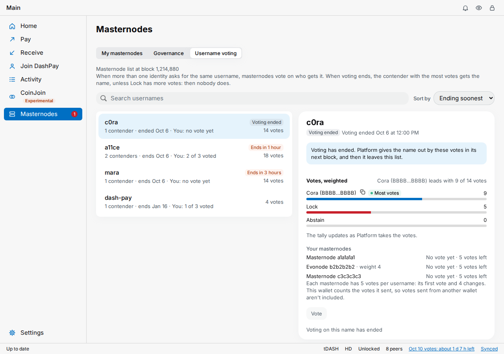
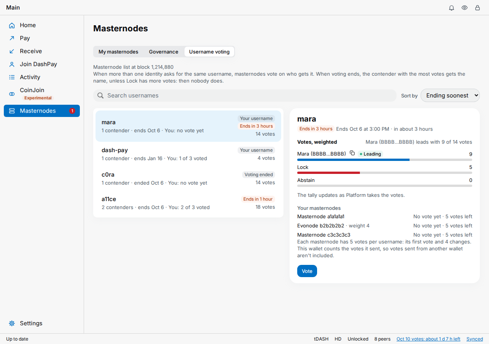
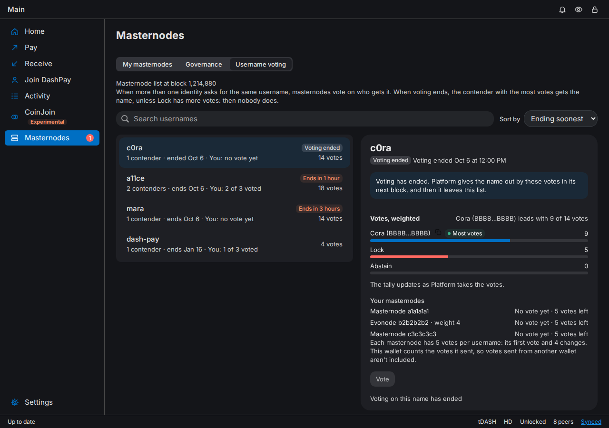
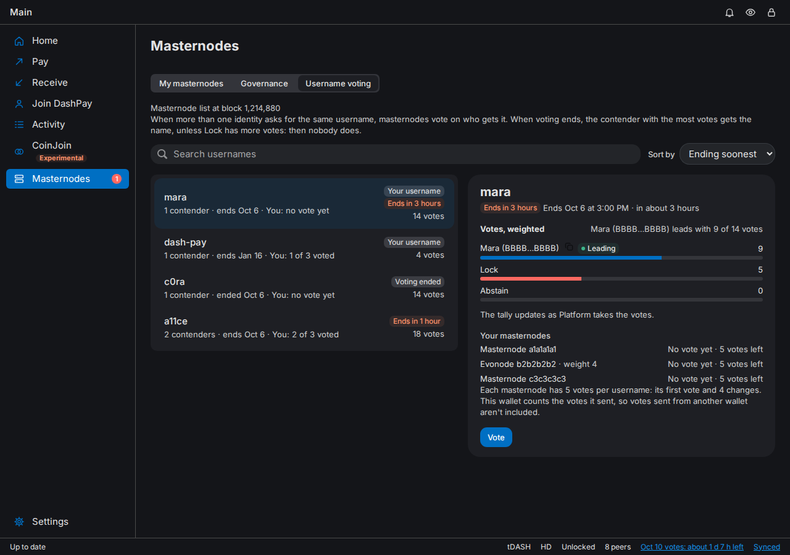
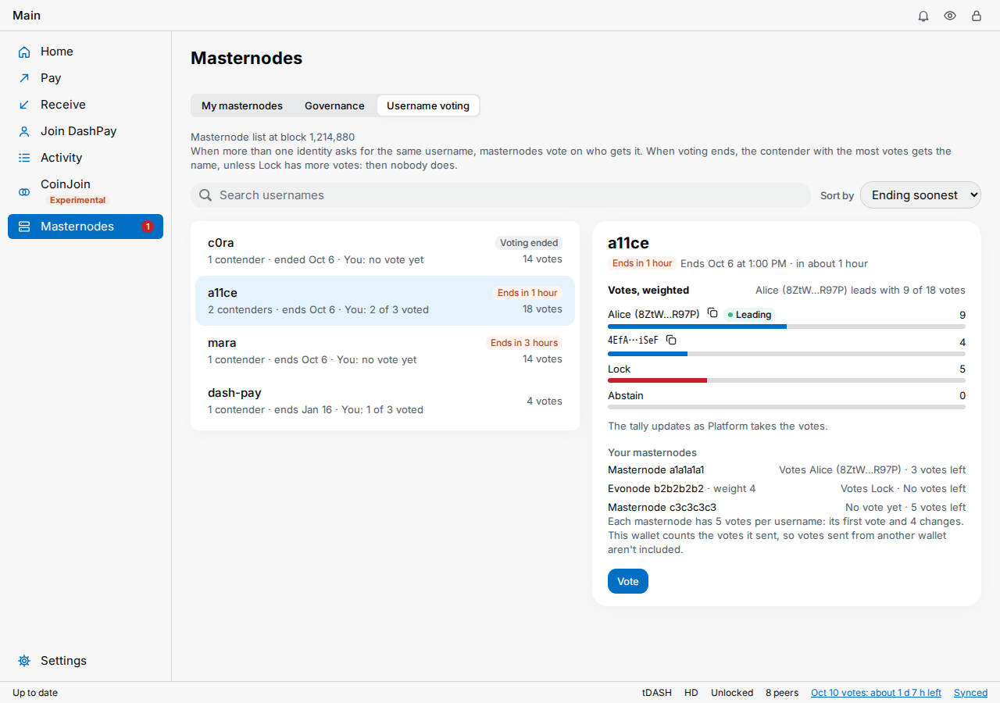
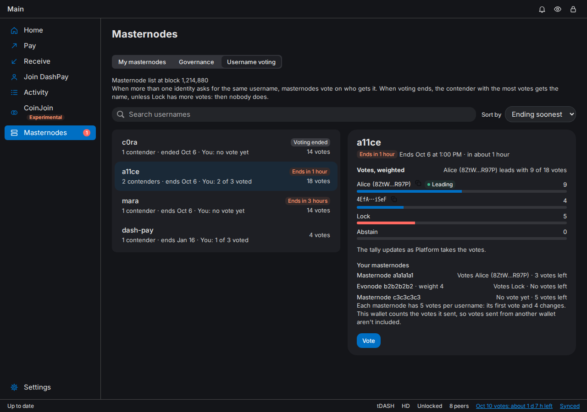

# Username voting in Dash Wallet Desktop

The Chromium fixture renderer ran inside the pinned Playwright 1.64.0 Docker image at 1280 × 900 with a fixed clock. Both revisions used the same synthetic contests in Ending soonest order. The owned-requests state contains active `mara` and `dash-pay`, just-ended `c0ra`, and the other wallet’s active `a11ce`.

| State | Before `fca6fa6b12f5e38b7c84b8d9e422972a213467cd` | After `6fe0d06ccce1dc95070dbb24ed19f4848765794c` |
| --- | --- | --- |
| Light, owned active requests |  |  |
| Dark, owned active requests |  |  |
| Light, no owned contests |  |  |
| Dark, no owned contests |  |  |

The after captures show the two active requests at the top with “Your username.” The ended request and other contest retain their relative order.

[Product pull request](https://github.com/PastaPastaPasta/dashwallet-desktop/pull/1148)
