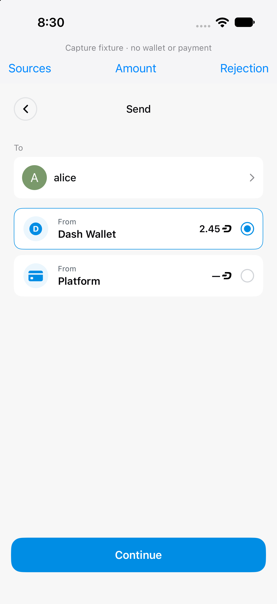
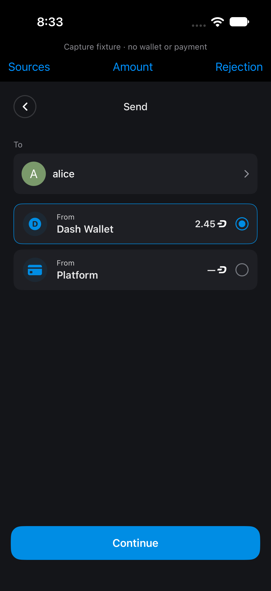
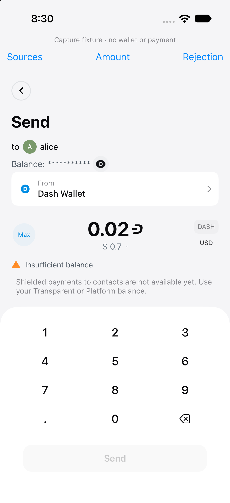
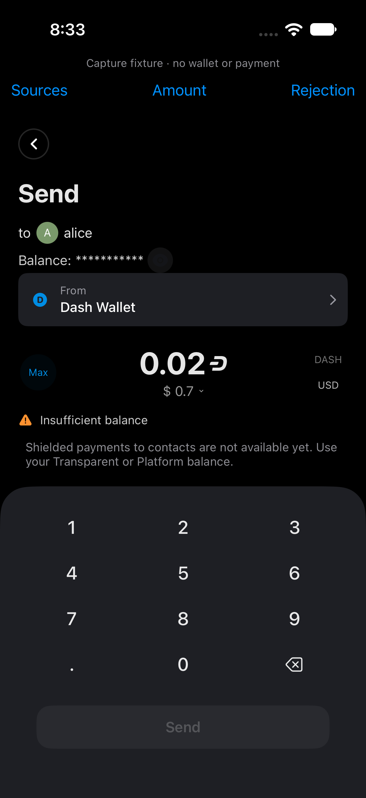
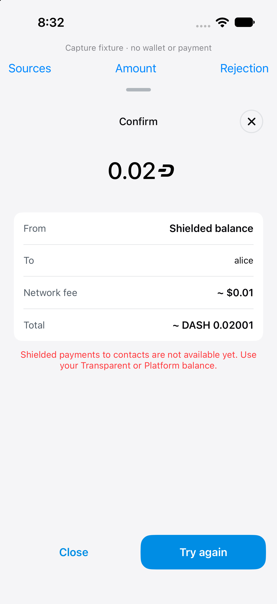
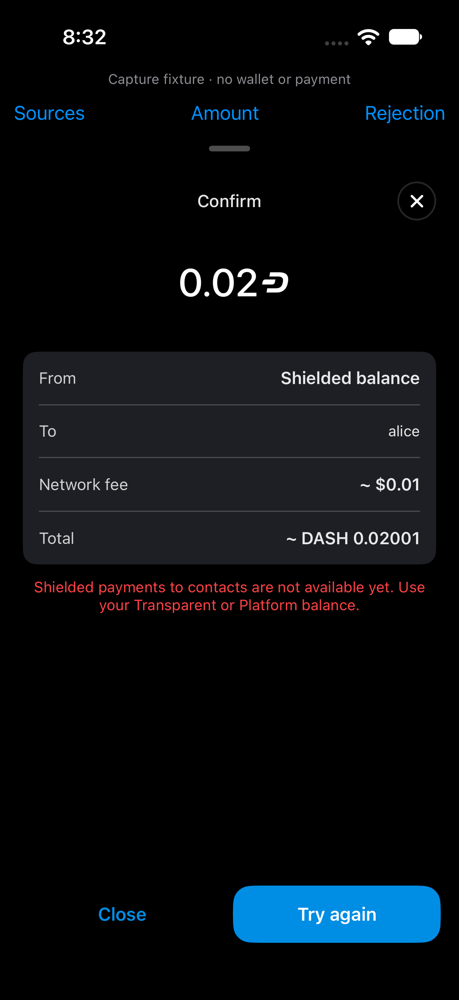

# DashPay contact funding — narrowed implementation

Product commit: [`b7f49a736ead0b6e87fe18ce8ebf28c7176a4638`](https://github.com/PastaPastaPasta/dashwallet-ios/commit/b7f49a736ead0b6e87fe18ce8ebf28c7176a4638). Base: `f6e507b5bcf2a9cd3aacdcec7d6d0cf9763e7826`. SDK: `6e113dc808f0bc53bb595a1ee5dab812619e564f`.

These are **after-only simulator fixtures**, not before/after comparisons or live payment evidence. Built on Pasta's Mac Studio from rebased parent `19a7bdaad516d2d336970560f4d11d9e7213ef1f` plus the exact narrowing changes committed above and the disclosed [capture-only patch](capture-only.patch). The patch was removed after capture; product file hashes were compared across both checkouts and are recorded in [product-sha256.json](product-sha256.json). Build-generated locale catalogs and CocoaPods version metadata were also reverted. No capture code is included in the product commit.

Device: iPhone 17 simulator, iOS 27.0, English, 1206 × 2622 PNG, light and dark appearance. Synthetic established contact `alice`; identity = 32 bytes `aa`, wallet = 32 bytes `71`, owner = 32 bytes `72`, testnet. No wallet, seed or live payment. The fixture uses the production source picker, amount screen, confirmation sheet and coordinator guard. It supplies preview balances and overrides spendability only to expose the picker. Transparent displays 2.45 DASH; Platform displays `—` because no live Platform account exists. The amount screen shows insufficient balance because there are no spendable coins.

| Surface | Light | Dark |
|---|---|---|
| Only Dash Wallet (Transparent) and Platform sources; Shielded absent |  |  |
| Amount screen explains deferred Shielded funding |  |  |
| Forced Shielded contact call rejected after Confirm |  |  |

The forced confirmation is reachable only through the capture wrapper. Shipping source selection cannot open it. The visible error proves refusal; the focused coordinator test verifies the refusal occurs before wallet resolution or journal reservation. Existing confirmation fee/amount labels in this forced screen are fixture data, not an offered Shielded contact quote.

Validation: one successful `xcodebuild build-for-testing` for `dashwallet-dashpay`, Debug arm64, four jobs; 18 ContactPaymentSourceTests plus the Shielded-contact execution refusal test passed (19 total, zero failures) using `test-without-building`. No full test matrix. Every final PNG was visually inspected at full resolution. Published raw files were fetched and matched to the hashes below.

## SHA-256

```
757f85bdaaa207f511c30b57535ed06cf185e5d2753d1a678216e7faa622edae  amount-dark.png
dd23c23d737f4bb5c96719858671cff4944747442513ee72b69e7faa5f5bade0  amount-light.png
c5b78ed84edd12ffe21124723dbb4f1e9e46fa12dc04261075f996c9ebcbbf86  rejection-dark.png
262ae18da50dabecb2a864f899ec61ced952fabfa2fa1d99459638378e9a4992  rejection-light.png
72d70d70c465b571ce125751ad74ed028ba3a084bea7699a8ae504ed7772b4c7  sources-dark.png
fcfe88580bce6eb6936afc3d78e8b94cd4de091d0ff46a0ff411c6a661ea0064  sources-light.png
```
